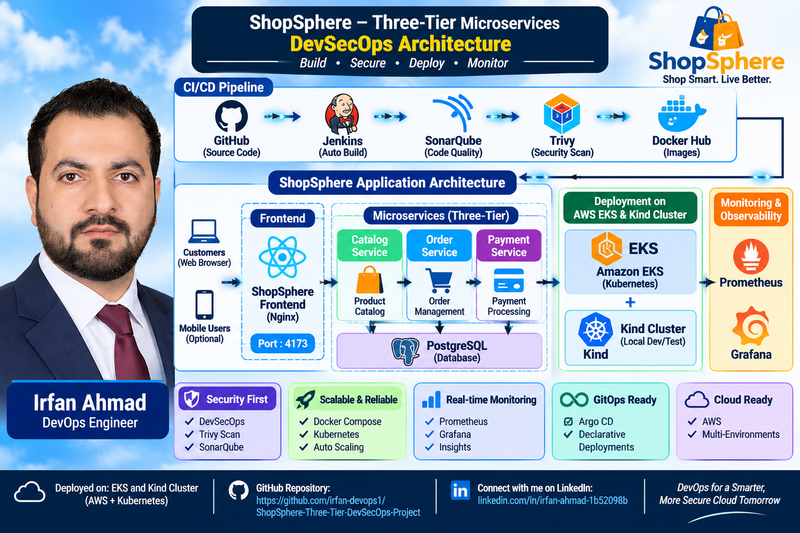
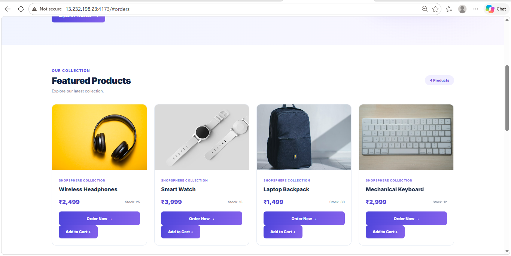
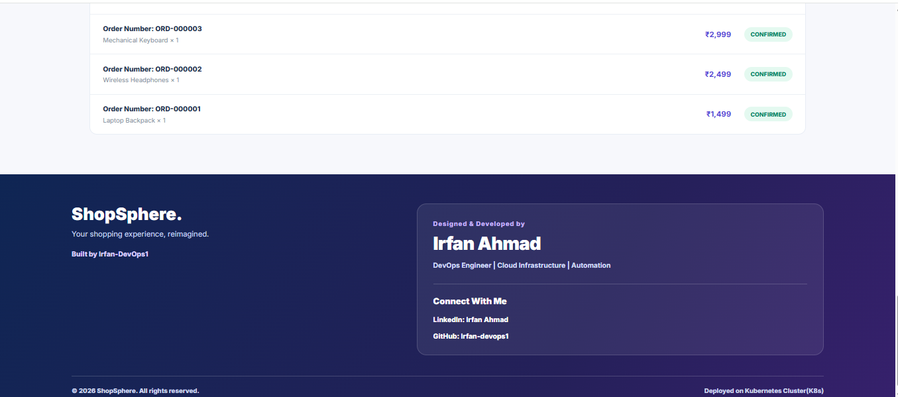
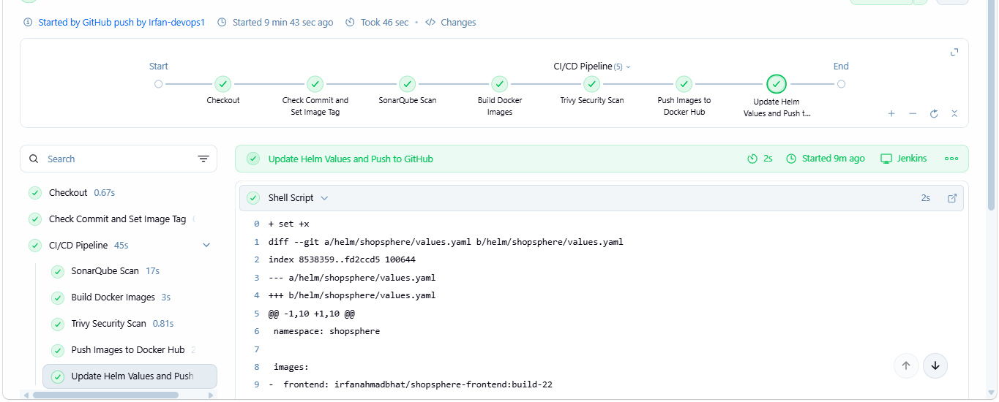
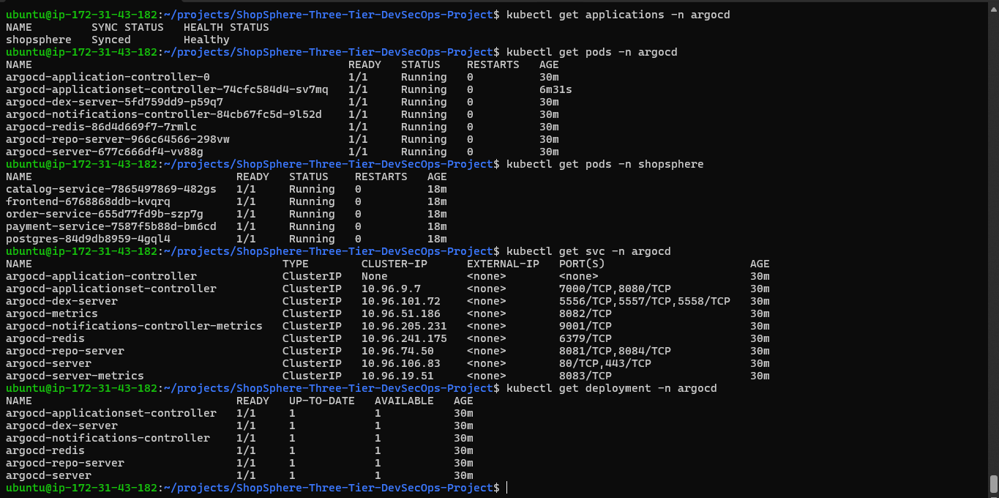
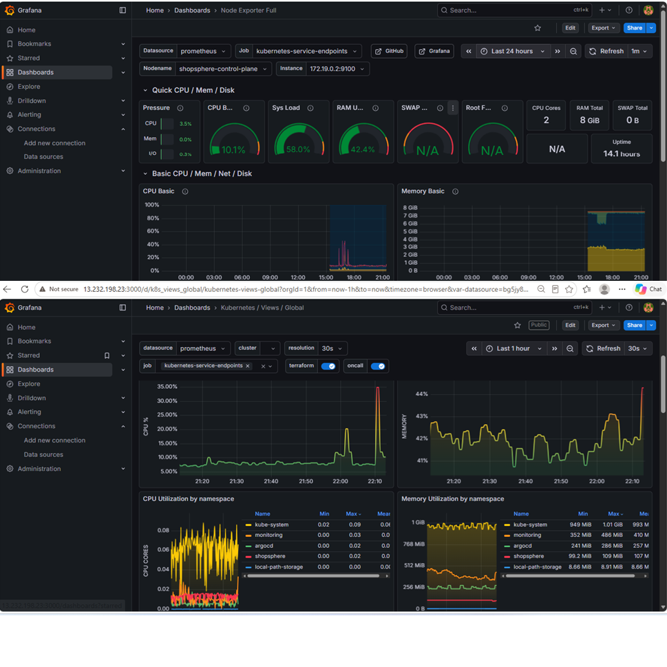

# ShopSphere – Three-Tier Microservices DevSecOps Project

A containerized e-commerce application demonstrating **end-to-end DevSecOps automation, CI/CD pipelines, container security, Kubernetes orchestration, GitOps, and infrastructure monitoring** using industry-standard tools.

## Architecture Diagram




## Project Overview

ShopSphere is a three-tier microservices-based e-commerce application consisting of a React frontend, three backend services, and a PostgreSQL database.

The project implements an automated DevSecOps workflow using Jenkins, SonarQube, Trivy, Docker, Kubernetes, Helm, and Argo CD.

## Application Architecture

### 1. Presentation Tier

| Component | Technology |
|---|---|
| Frontend | React |
| Web Server | Nginx |

### 2. Application Tier

| Service | Responsibility |
|---|---|
| Catalog Service | Product catalog management |
| Order Service | Order processing |
| Payment Service | Payment processing |

### 3. Database Tier

| Component | Technology |
|---|---|
| Database | PostgreSQL |

## Technology Stack

| Category | Tools |
|---|---|
| Cloud Platform | AWS EC2 |
| Version Control | Git, GitHub |
| CI/CD Automation | Jenkins |
| Code Quality | SonarQube |
| Containerization | Docker, Docker Compose |
| Container Security | Trivy |
| Container Orchestration | Kubernetes (Kind) |
| Package Management | Helm |
| GitOps | Argo CD |
| Monitoring & Visualization | Prometheus, Grafana |
| Database | PostgreSQL |
| Web Server | Nginx |

## DevSecOps CI/CD Workflow

1. Developer pushes code to GitHub.
2. GitHub webhook triggers the Jenkins pipeline.
3. Jenkins checks out the source code.
4. SonarQube performs static code quality analysis.
5. Jenkins builds Docker images for the frontend and backend services.
6. Trivy scans container images for security vulnerabilities.
7. Jenkins pushes the images to Docker Hub.
8. Jenkins updates image tags in the Helm configuration and pushes the changes to GitHub.
9. Argo CD detects repository changes and synchronizes the application with Kubernetes.
10. Prometheus and Grafana provide monitoring and visualization.

## Deployment Environments

| Environment | Deployment Method |
|---|---|
| Application Testing | Docker Compose on AWS EC2 |
| Kubernetes Deployment | Kind cluster on AWS EC2 |
| Application Packaging | Helm |
| Continuous Deployment | Argo CD |

## Project Screenshots

### 1. Application

**ShopSphere Homepage**


**Product Catalog**



**Order Workflow**



### 2. CI/CD and Security

**Jenkins Pipeline**



**SonarQube Dashboard**


**Trivy Security Scan**


**Docker Hub Images**


### 3. Kubernetes, GitOps and Monitoring

**Argo CD Synchronization and Health**


**Kubernetes Resources**



**Grafana Kubernetes Dashboard**


**Grafana Node Exporter Dashboard**



## Repository Structure

```text
ShopSphere-Three-Tier-DevSecOps-Project/
├── application/
│   ├── catalog-service/
│   ├── frontend/
│   ├── order-service/
│   └── payment-service/
├── database/
│   └── init.sql
├── helm/
│   └── shopsphere/
├── screenshots/
├── Jenkinsfile
├── docker-compose.yml
├── INSTALLATION-GUIDE.md
├── LICENSE
└── README.md
```

## Getting Started

### 1. Clone the Repository

```bash
git clone https://github.com/Irfan-devops1/ShopSphere-Three-Tier-DevSecOps-Project.git

cd ShopSphere-Three-Tier-DevSecOps-Project
```

### 2. Configure Environment Variables

Create a `.env` file in the project root:

```bash
echo "DB_PASSWORD=change-this-password" > .env
chmod 600 .env
```

Replace the example value with a strong password. Never commit `.env` or real credentials to GitHub.

### 3. Start the Application

```bash
docker compose pull
docker compose up -d
```

### 4. Verify Running Containers

```bash
docker compose ps
```

### 5. Access the Application

```text
http://YOUR-EC2-PUBLIC-IP:4173
```

Ensure inbound TCP port `4173` is allowed in the EC2 security group.

For complete installation and configuration instructions covering Docker, Jenkins, SonarQube, Trivy, Kind, Helm, Argo CD, Prometheus, and Grafana, refer to **[INSTALLATION-GUIDE.md](INSTALLATION-GUIDE.md)**.

## Key DevSecOps Implementations

- Automated CI/CD using Jenkins and GitHub webhooks.
- Static code analysis using SonarQube.
- Container vulnerability scanning using Trivy.
- Automated Docker image build and push to Docker Hub.
- Kubernetes application deployment using Helm.
- GitOps-based continuous deployment using Argo CD.
- Monitoring and visualization using Prometheus and Grafana.
- Multi-service application deployment using Docker Compose and Kubernetes.

## Author

**Irfan Ahmad**

- GitHub: [Irfan-devops1](https://github.com/Irfan-devops1)
- LinkedIn: [Irfan Ahmad](https://linkedin.com/in/irfan-ahmad-1b52098b)

## Project Repository

[https://github.com/Irfan-devops1/ShopSphere-Three-Tier-DevSecOps-Project.git](https://github.com/Irfan-devops1/ShopSphere-Three-Tier-DevSecOps-Project.git)

---

*Built to demonstrate practical DevOps and DevSecOps engineering skills through automation, containerization, Kubernetes, GitOps, security scanning, and monitoring.*
