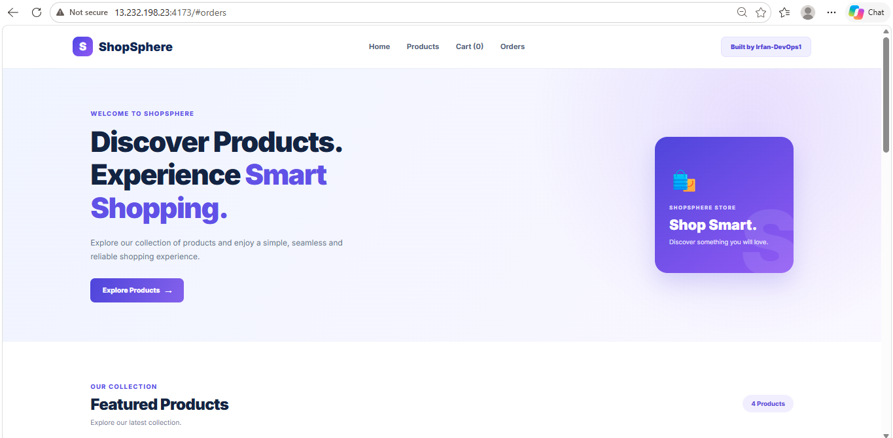
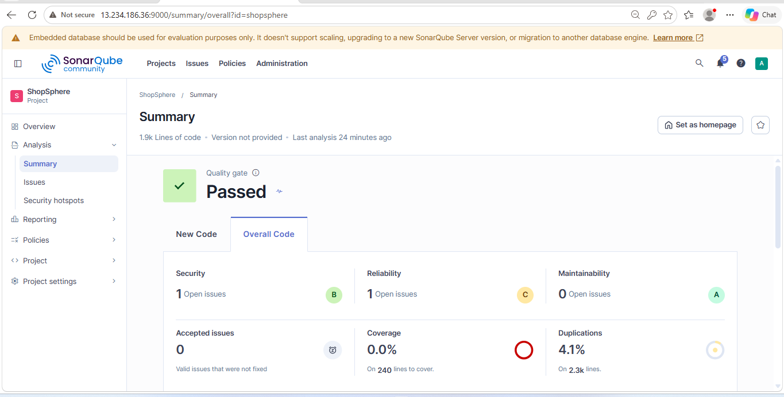
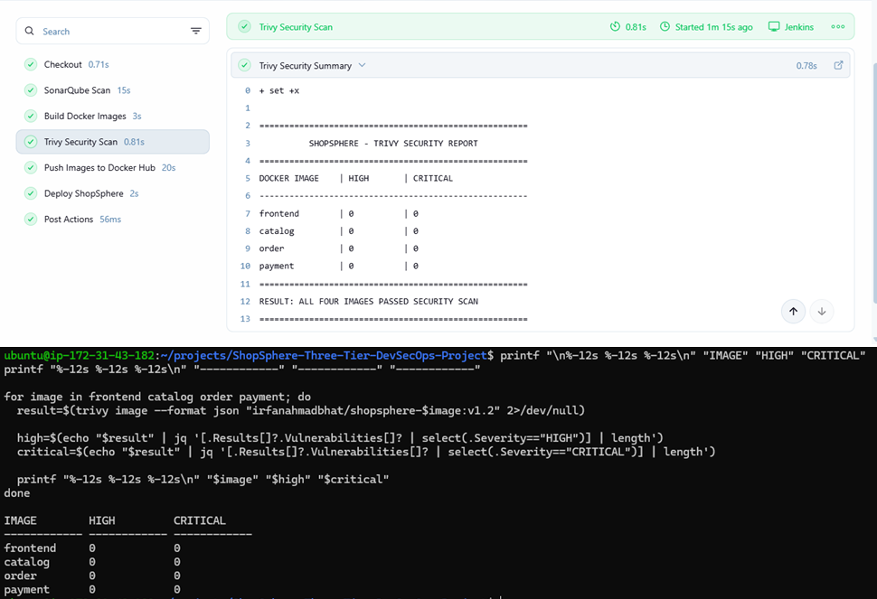
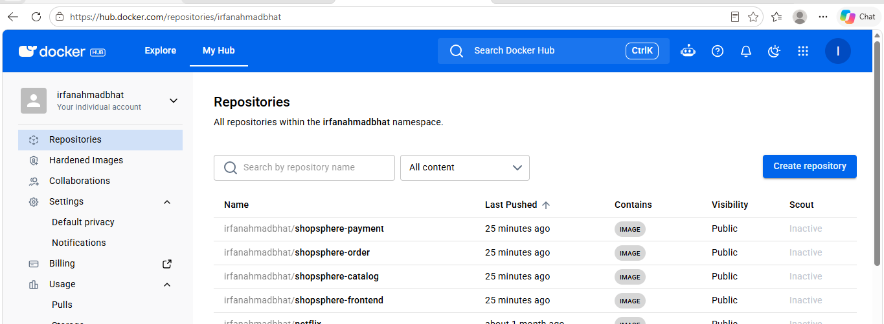
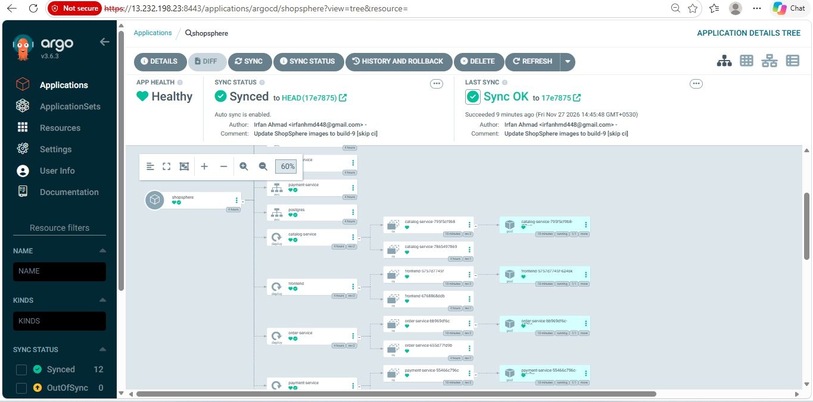
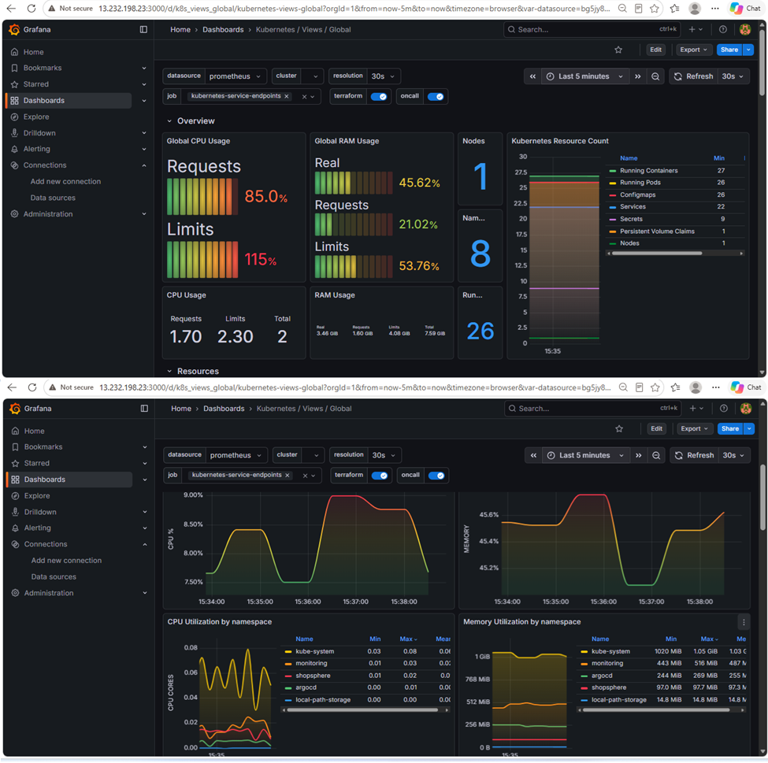

# ShopSphere – Three-Tier Microservices DevSecOps Project

A production-style DevSecOps implementation demonstrating automated CI/CD, containerization, security scanning, GitOps-based deployment, Kubernetes orchestration, and continuous monitoring.

## Project Overview

ShopSphere is a three-tier microservices-based application automated through a Jenkins CI/CD pipeline.

The project integrates security scanning, Docker image management, Helm-based Kubernetes deployment, Argo CD GitOps, and Prometheus-Grafana monitoring.

**Project Developer:** Irfan Ahmad

## Architecture


### Application Architecture

| Tier | Components |
|---|---|
| Presentation | React Frontend with Nginx |
| Application | Catalog Service, Order Service, Payment Service |
| Database | PostgreSQL |

## Technology Stack

| Category | Tools |
|---|---|
| Cloud | AWS EC2 |
| Source Control | Git, GitHub |
| CI/CD | Jenkins |
| Code Quality | SonarQube |
| Security Scanning | Trivy |
| Containerization | Docker, Docker Compose |
| Container Registry | Docker Hub |
| Orchestration | Kubernetes (Kind) |
| Deployment | Helm, Argo CD |
| Monitoring | Prometheus, Grafana |
| Database | PostgreSQL |
| Operating System | Ubuntu Linux |

## CI/CD Pipeline

**Workflow:**

GitHub → Jenkins → SonarQube → Trivy → Docker Build → Docker Hub → Helm → Argo CD → Kubernetes

1. Developer pushes code to GitHub.
2. GitHub webhook triggers Jenkins.
3. Jenkins checks out the source code.
4. SonarQube performs code quality analysis.
5. Docker builds the application images.
6. Trivy scans images for HIGH and CRITICAL vulnerabilities.
7. Jenkins pushes approved images to Docker Hub.
8. Jenkins updates Helm image tags in GitHub.
9. Argo CD detects Git changes and synchronizes the deployment.
10. Kubernetes runs the application containers.

## Deployment Architecture

The project uses Kubernetes and Helm for application deployment, with Argo CD implementing GitOps-based synchronization.

The demonstrated application deployment was performed on a Kubernetes Kind cluster running on AWS EC2. The architecture can also be adapted for AWS EKS.

## Monitoring

Prometheus collects infrastructure and Kubernetes metrics, while Grafana provides visualization through dashboards.

## Project Screenshots

### Application




### CI/CD and Security








### Kubernetes and GitOps




### Monitoring




## Repository Structure

```text
ShopSphere-Three-Tier-DevSecOps-Project/
├── application/
│   ├── frontend/
│   ├── catalog-service/
│   ├── order-service/
│   └── payment-service/
├── database/
│   └── init.sql
├── helm/
│   └── shopsphere/
├── screenshots/
├── Jenkinsfile
├── docker-compose.yml
├── README.md
└── INSTALLATION-GUIDE.md
```

## Getting Started

For complete installation instructions, infrastructure setup, CI/CD configuration, and deployment commands, see:

[INSTALLATION-GUIDE.md](INSTALLATION-GUIDE.md)

For local application execution using Docker Compose:

```bash
cp .env.example .env
```

Configure `DB_PASSWORD` in `.env`, then run:

```bash
docker compose up -d
```

Access the application:

```text
http://localhost:4173
```

## Key Highlights

- Automated CI/CD using Jenkins.
- Code quality analysis with SonarQube.
- Container vulnerability scanning with Trivy.
- Docker image versioning and publishing.
- Kubernetes deployments using Helm.
- GitOps automation with Argo CD.
- Monitoring using Prometheus and Grafana.
- Three-tier microservices architecture.

## Project Links

- **GitHub Repository:** https://github.com/Irfan-devops1/ShopSphere-Three-Tier-DevSecOps-Project
- **GitHub Profile:** https://github.com/Irfan-devops1
- **LinkedIn:** https://linkedin.com/in/irfan-ahmad-1b52098b

---

Developed by **Irfan Ahmad** | DevOps Engineer
